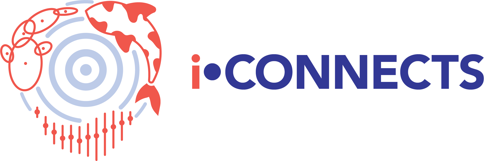
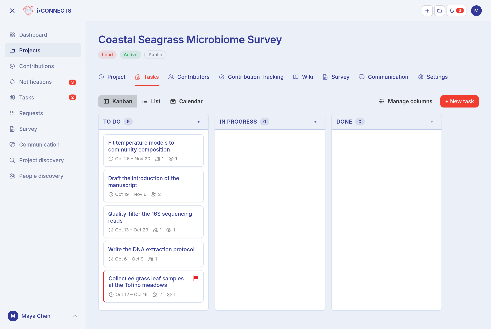
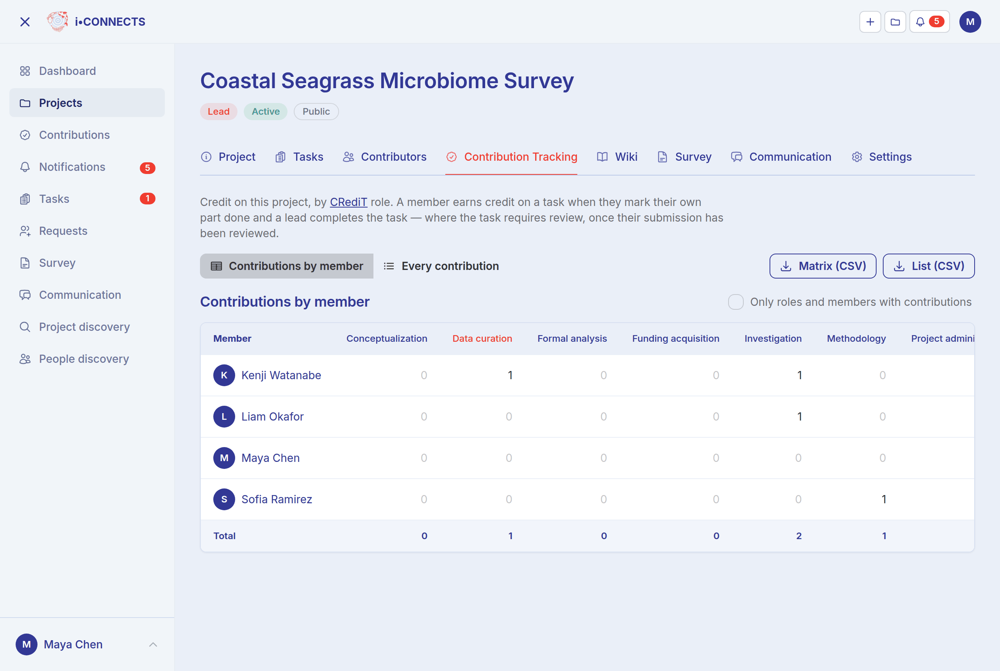

<p align="center">
  
</p>

<h1 align="center">i•CONNECTS</h1>

<p align="center">
  <strong>Track who did what in research collaborations.</strong><br>
  A free, scientist-focused platform for coordinating distributed research projects
  and making contribution credit transparent, verifiable and portable.
</p>

<p align="center">
  <a href="https://github.com/cossee-org/i-connects/actions/workflows/ci.yml"></a>
  
  
</p>

---

i•CONNECTS (*infrastructure for Collaborative Open Network Nurturing Equity,
Co-creation & Team Science*) is built for systematic reviews, meta-analyses and
coordinated distributed experiments in ecology, biology and medicine: projects
where dozens of people across many institutions each do a piece of the work,
and where getting authorship and credit right matters.

Every task in a project can carry a [CRediT](https://credit.niso.org/)
contributor role. When a project lead verifies someone's part of a task, that
becomes a permanent, attributable entry in the project's contribution ledger,
which you can download as a spreadsheet for your authorship or CRediT
statement.

<p align="center">
  
  
</p>

## Contents

- [Features](#features)
- [Quick start](#quick-start)
- [Running without Docker](#running-without-docker)
- [Configuration](#configuration)
- [Tests](#tests)
- [Tech stack](#tech-stack)
- [Project layout](#project-layout)
- [Documentation](#documentation)
- [Contributing](#contributing)
- [License](#license)

## Features

### Projects and tasks

- **Projects** with public or private visibility, invitations, join requests,
  and Lead / Contributor privileges.
- **Tasks** viewed as a Kanban board (drag and drop), a list, a table or a
  calendar, with milestones, priorities and flags.
- **Per-person dates and timezones**: a task has its own start date, deadline
  and timezone, and a lead can give individual assignees their own.
- **Peer review**: tick *Require review* on a task and its reviewers check each
  assignee's submission before a lead signs it off.
- **Bulk CSV import** for seeding a board with dozens of tasks at once.
- **Calendar feed** (iCalendar) of project milestones for Google Calendar,
  Apple Calendar or Outlook.
- **GitHub links**: a task can point at a GitHub issue or pull request.

### Contribution credit

- **CRediT roles**: a project can opt into the CRediT taxonomy when it is
  created, and each task then carries one of CRediT's 14 contributor roles.
- **A verified ledger**: a lead's verification of a member's work writes the
  credit. Withdrawing the verification takes it back.
- **Leads can correct it**: change the role a contribution was recorded under,
  withdraw an entry, or add one by hand for work done outside a task. Every
  change is audit-logged.
- **CSV downloads**: a members × roles matrix, or one row per contribution.
- **Researcher profiles** show a person's public projects and their CRediT
  contributions across the platform.

### Collaboration

- **Comments** on tasks, with `@mentions` of project contributors, which send
  an in-app notification and an email.
- **Wiki**: per-project Markdown pages with `[[wiki links]]`, full revision
  history with diffs and restore, page locking and search.
- **Notes**: per-project Markdown notes visible to you only, to leads, or to
  all contributors.
- **Notifications**: in-app, plus email for assignments, mentions, overdue
  reminders, and daily or weekly digests.
- **Mailing list**: leads can email every member of a project, and later
  members can read the archive on the site.
- **People and project discovery**: search everyone on the platform by name,
  institution, city, country or ORCID iD.
- **Discord**: optional announcements to a project's Discord channel.

### Accounts and trust

- Email sign-up with confirmation, plus optional **ORCID** sign-in.
- **Account lockout** after repeated failed sign-ins, with a one-time unlock
  link by email.
- An append-only **audit log** of sign-ins and of project, membership, role,
  task and contribution changes.
- Built to **WCAG 2.1 AA**: skip link, visible focus, landmarks, labelled
  controls and accessible data tables.

## Quick start

The quickest way to try i•CONNECTS is with Docker. You need
[Docker](https://docs.docker.com/get-docker/) with Compose v2 and nothing else.

```bash
git clone https://github.com/cossee-org/i-connects.git
```

```bash
cd i-connects
```

```bash
cp .env.example .env
```

```bash
docker compose up -d --build
```

This starts PostgreSQL, Redis, the web app, a Celery worker and Celery beat.
The first build takes a few minutes. When `docker compose ps` shows every
service as `(healthy)`, open <http://localhost:8000/>.

### Load demo data

```bash
docker compose exec web python manage.py seed_demo
```

This creates a demo project, "Demo: bird song meta-analysis", with tasks and
contributions already recorded, and three accounts you can sign in as:

| Email                  | Role in the demo project |
| ---------------------- | ------------------------ |
| `alice@iconnects.test` | Lead                     |
| `bob@iconnects.test`   | Contributor              |
| `cara@iconnects.test`  | Contributor              |

All three use the password `demopass`. `seed_demo` refuses to run unless
`DEBUG` is on, so it can't be run against a production site.

To create an admin account instead:

```bash
docker compose exec web python manage.py createsuperuser
```

### After pulling new code

The `web` container serves the code from your checkout, but migrations run only
when it starts. After pulling changes to the models, apply them:

```bash
docker compose exec web python manage.py migrate
```

In development the site tells you when migrations are outstanding.

## Running without Docker

You need Python 3.12, Node 20 or later, PostgreSQL 16 and Redis 7.

```bash
python3.12 -m venv .venv
source .venv/bin/activate
pip install -r requirements.txt
cp .env.example .env
```

In `.env`, change the host in `DATABASE_URL`, `REDIS_URL`,
`CELERY_BROKER_URL` and `CELERY_RESULT_BACKEND` from `db` / `redis` to
`localhost`. Then build the stylesheet and start the server:

```bash
npm install
npm run build:css
python manage.py migrate
python manage.py runserver
```

Use `npm run watch:css` instead of `build:css` to rebuild the CSS as you edit
templates. Background jobs (emails, digests, reminders) need Celery, each in its
own shell:

```bash
celery -A config worker -l info
```

```bash
celery -A config beat -l info --scheduler django_celery_beat.schedulers:DatabaseScheduler
```

Run `python manage.py setup_cron` once to create the scheduled jobs (digests,
overdue reminders and clean-up). With Docker, that is
`docker compose exec web python manage.py setup_cron`.

## Configuration

All settings come from environment variables, read from `.env`.
[`.env.example`](.env.example) lists each one with an explanation. Its defaults
work for local development as they are. The ones you are most likely to change:

| Variable | Purpose |
| --- | --- |
| `DJANGO_SETTINGS_MODULE` | `config.settings.dev` locally, `config.settings.prod` in production |
| `DJANGO_SECRET_KEY` | Must be a long random value in production |
| `DJANGO_ALLOWED_HOSTS` | Comma-separated host names the site answers to |
| `DATABASE_URL` | PostgreSQL connection URL |
| `REDIS_URL`, `CELERY_BROKER_URL`, `CELERY_RESULT_BACKEND` | Redis for caching and Celery |
| `DEFAULT_FROM_EMAIL` | Sender address, as `Name <address@example.com>` |
| `SITE_URL` | Absolute base URL used for links in emails |
| `ORCID_SANDBOX` | `true` (default) uses sandbox.orcid.org; `false` uses orcid.org |

ORCID sign-in needs an ORCID client ID and secret, added as a *Social
application* in the Django admin.

For a production deployment (Docker Compose behind Caddy with automatic TLS,
backups, monitoring and secret rotation), see [DEPLOYMENT.md](DEPLOYMENT.md).

## Tests

```bash
pytest -q
```

The suite has over 800 tests and runs against an in-memory SQLite database,
so it needs neither PostgreSQL nor Redis. CI also checks for missing
migrations, builds the CSS and the Docker image, validates the Compose files
and lints the shell scripts. See
[`.github/workflows/ci.yml`](.github/workflows/ci.yml).

## Tech stack

- **Backend:** Python 3.12, Django 5.2, Django REST Framework, django-allauth (ORCID)
- **Frontend:** server-rendered templates with HTMX, Alpine.js and SortableJS;
  Tailwind CSS with DaisyUI
- **Data:** PostgreSQL 16, Redis 7
- **Background jobs:** Celery with django-celery-beat
- **Serving:** gunicorn and WhiteNoise, behind Caddy in production
- **Email:** SMTP, Resend or Amazon SES

## Project layout

```
config/            Django settings (base, dev, prod, test), URLs, Celery
apps/
  accounts/        Users, sign-up and sign-in, ORCID, lockout, profiles
  projects/        Projects, members, privileges, invitations, join requests
  tasks/           Tasks, Kanban boards, milestones, dates and timezones, CSV import, iCal
  contributions/   The CRediT contribution ledger and its CSV downloads
  comments/        Task comments and @mentions
  wiki/            Project wiki pages and revision history
  notes/           Project notes
  notifications/   In-app and email notifications
  mailing_list/    Project announcement emails and their archive
  audit/           Append-only audit log
  roles/           Project roles
  integrations/    Discord webhooks
  forms_builder/   JSON-Schema surveys (not yet in the UI)
  communications/  Placeholder for a future module
  core/            Landing page, shared enums, email backends, management commands
cron/              Scheduled Celery jobs (digests, overdue reminders, clean-up)
templates/         Django templates, with shared pieces in _components/
static/            Tailwind source, built CSS, vendored JS, images
scripts/           Backup, restore and container helper scripts
documentation/     User guide (PDF and Word) and the tools that build it
```

## Documentation

| Document | What it covers |
| --- | --- |
| [User guide (PDF)](documentation/i-CONNECTS_User_Guide.pdf) | Step-by-step guide for researchers, with screenshots |
| [DEMO_DEPLOYMENT.md](DEMO_DEPLOYMENT.md) | Running a local demo, in more detail than above |
| [DEPLOYMENT.md](DEPLOYMENT.md) | Production deployment and day-to-day operations |
| [GDRIVE_BACKUP.md](GDRIVE_BACKUP.md) | Encrypted off-site backups to Google Drive |
| [PERSISTENCE_DRILL.md](PERSISTENCE_DRILL.md) | A drill to prove data survives crashes and restarts |
| [SECURITY_AUDIT.md](SECURITY_AUDIT.md) | Security review of the application and deployment |
| [STYLE_GUIDE.md](STYLE_GUIDE.md) | Brand colours, page structure and UI components |
| [A11Y_GUIDE.md](A11Y_GUIDE.md) | The accessibility checklist every template follows |
| [AUDIT_GUIDE.md](AUDIT_GUIDE.md) | How audit-log events are defined and recorded |

## Contributing

Bug reports and suggestions are welcome as
[GitHub issues](https://github.com/cossee-org/i-connects/issues).

If you'd like to send a change:

1. Fork the repository and create a branch from `main`.
2. Make your change, with tests where it changes behaviour.
3. Run `pytest -q`. If you changed a model, run
   `python manage.py makemigrations` and commit the migration.
4. Follow [STYLE_GUIDE.md](STYLE_GUIDE.md) and
   [A11Y_GUIDE.md](A11Y_GUIDE.md) for any template changes.
5. Open a pull request against `main`. CI must pass before it can be merged.

Please report security vulnerabilities privately to the maintainers, through
the repository's [Security tab](https://github.com/cossee-org/i-connects/security),
not in a public issue.

## License

No open-source license has been chosen for this repository yet. Until one is
added, all rights are reserved by the authors.
